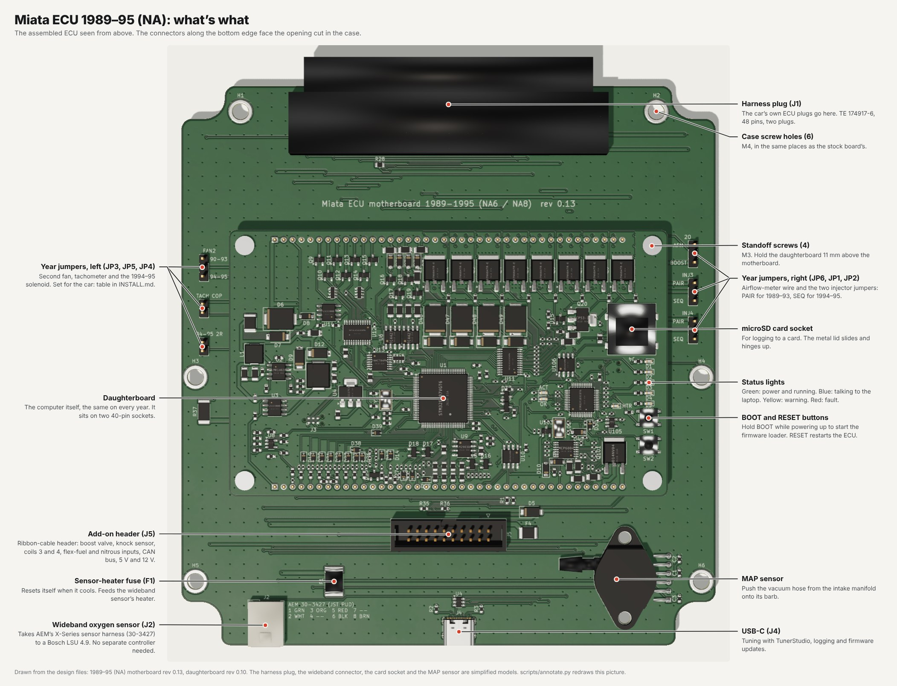
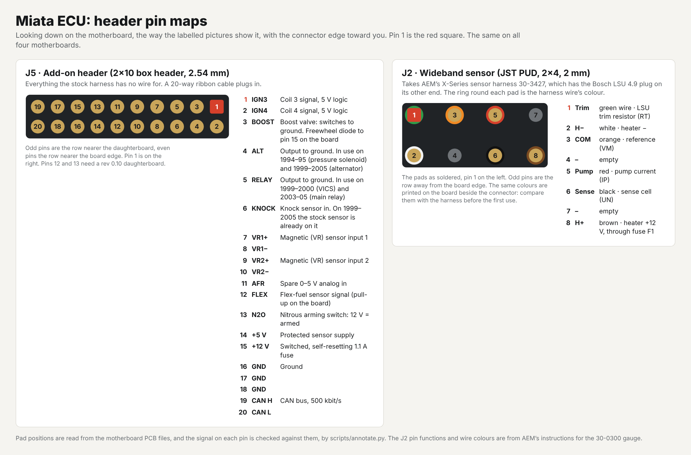

# Installing the ECU

How to fit the ECU to a 1990–2005 Miata and start the engine for the first time.

> **Read this first.** No board has been built or run in a car yet. This guide is written from the design files and
> from the published install procedures of other plug-in Miata ECUs (listed under [Sources](#sources)). Steps that
> nobody has checked on this hardware are marked **unchecked**. Expect corrections after the first install.
>
> The ECU replaces an emissions-certified engine computer. It is for off-road and competition use.

**Contents:** [What's what](#whats-what) · [What you need](#what-you-need) · [1. Bench check](#1-bench-check) ·
[2. Remove the stock ECU](#2-remove-the-stock-ecu) · [3. Fit the board in the case](#3-fit-the-board-in-the-case) ·
[4. Year-specific steps](#4-year-specific-steps) · [5. MAP hose](#5-map-hose) ·
[6. Wideband sensor](#6-wideband-sensor) · [7. Air temperature](#7-air-temperature) ·
[8. First start](#8-first-start) · [9. Add-ons](#9-add-ons-on-the-add-on-header) · [If something's wrong](#if-somethings-wrong)

## What's what

The layout below the harness plug is the same on every year: only the harness plug, a few option links and, on the
1989–95 board, the six year jumpers along the side edges change.
The pictures show green solder mask; yours is whatever colour you ordered.

| Year | Assembled | Motherboard alone (sockets, fuses, jumpers, option links) |
|---|---|---|
| 1989–95 | [picture](images/annotated_1989-95.jpg) | [picture](images/annotated_motherboard_1989-95.jpg) |
| 1996–97 | [picture](images/annotated_1996-97.jpg) | [picture](images/annotated_motherboard_1996-97.jpg) |
| 1999–2000 | [picture](images/annotated_1999-2000.jpg) | [picture](images/annotated_motherboard_1999-2000.jpg) |
| 2001–05 | [picture](images/annotated_2001-05.jpg) | [picture](images/annotated_motherboard_2001-05.jpg) |

Which harness pin carries which signal is in each motherboard's README
([1989–95](motherboards/1989-95/README.md), [1996–97](motherboards/1996-97/README.md),
[1999–2000](motherboards/1999-2000/README.md), [2001–05](motherboards/2001-05/README.md)).

### Header pin maps

Looking down on the board with the connector edge toward you. The same on all four motherboards.

**J5, add-on header** (2×10 box header, 2.54 mm; a 20-way ribbon cable plugs in). Pin 1 is at the right; odd pins are
the row nearer the daughterboard.

| Pin | Signal | What it is |
|---|---|---|
| 1 | IGN3 | Coil 3 signal, 5 V logic (coil-on-plug: cylinder 2) |
| 2 | IGN4 | Coil 4 signal, 5 V logic (coil-on-plug: cylinder 4) |
| 3 | BOOST | Boost valve output: switches to ground. A freewheel diode to pin 15 is on the board |
| 4 | ALT | Output to ground. In use on 1994–95 (pressure-regulator solenoid wire) and 1999–2005 (alternator) |
| 5 | RELAY | Output to ground. In use on 1999–2000 (VICS) and 2003–05 (main relay) |
| 6 | KNOCK | Knock sensor input. On 1999–2005 the stock sensor is already on it |
| 7, 8 | VR1+, VR1− | Magnetic (VR) sensor input 1 |
| 9, 10 | VR2+, VR2− | Magnetic (VR) sensor input 2 |
| 11 | AFR | Spare 0–5 V analog input |
| 12 | FLEX | Flex-fuel sensor signal. The 4.7 kΩ pull-up to 5 V is on the board |
| 13 | N2O | Nitrous arming switch: 12 V = armed. The pull-down is on the board |
| 14 | +5 V | Protected sensor supply |
| 15 | +12 V | Switched with the ECU, self-resetting 1.1 A fuse |
| 16, 17, 18 | GND | Ground |
| 19 | CAN H | CAN bus, 500 kbit/s: the bus the on-board wideband reports on |
| 20 | CAN L | |

Pins 12 and 13 need a rev 0.10 daughterboard.

**J2, wideband sensor** (JST PUD header S08B-PUDSS-1: two rows of four at 2 mm), for **AEM's X-Series sensor harness
30-3427**, which has the Bosch LSU 4.9 plug on its other end. Pin 1 is at the left. Pins 1 and 2 are the first
column; odd pins are the row away from the board edge.

| Pin | AEM's name | AEM harness wire | LSU 4.9 signal |
|---|---|---|---|
| 1 | Trim resistor | green | RT |
| 2 | Heater − | white | H− |
| 3 | COM | orange | VM, reference |
| 5 | Pump current | red | IP |
| 6 | Sense | black | UN, sense cell |
| 8 | Heater + | brown | H+, 12 V through the board's 3 A fuse |
| 4, 7 | not used | | |

The pin functions and wire colours are from AEM's instructions for the 30-0300 gauge. The same instructions name the
harness's replacement terminal, JST SPUD-001T-P0.5, which is the contact of JST's PUD connectors: that is how the
connector was identified. **Nobody has plugged a harness into this board yet**, and AEM does not say which cavity is
pin 1 (the board follows JST's numbering). Each pin's wire colour is printed on the board beside J2: compare the
harness with the print before plugging a sensor in, and stop if they differ.

**1989–95 motherboard jumpers** (three-pin and two-pin headers with shunts, along the side edges). Set them for the
car before the first start:

| Jumper | 1989–93 | 1994–95 | What it does |
|---|---|---|---|
| JP1, JP2 (INJ3, INJ4) | PAIR | SEQ | PAIR: two injector drivers share each of the two injector wires. SEQ: one wire per injector. **Never SEQ on a 1989–93 automatic** |
| JP3 (FAN2) | 90-93 | 94-95 | Which harness pin the second fan relay is on |
| JP4 (94-95 2R) | open | fitted | The 1994–95 pressure-regulator solenoid |
| JP5 (TACH COP) | open | open | Fit only after a coil-on-plug conversion with the igniter removed |
| JP6 (2O) | AFM | AFM | BOOST: the boost valve output on the airflow meter's old signal wire, once the meter is gone |

The full table is in the [1989–95 README](motherboards/1989-95/README.md).

## What you need

Everything is on the [parts page](additional-parts/shopping_list.html), with quantities.

- The ECU: a daughterboard on your year's motherboard, with firmware loaded ([firmware/README.md](firmware/README.md)).
- **Your stock ECU's case.** The board goes in it (1990–95; the 1996–2005 fit is unchecked).
- A **Bosch LSU 4.9** wideband sensor (0 258 017 025), genuine, and **AEM's X-Series sensor harness 30-3427** from it
  to J2.
- **Vacuum hose**, 3–4 mm inside diameter, about 3 m, and a **4 mm barbed tee**.
- A USB-C cable and a laptop with [TunerStudio](https://www.tunerstudio.com/).
- A multimeter and a timing light.
- 1990–93 manual cars: optionally, the throttle position sensor kit ([README](README.md#throttle-position-sensor-198993-manual-cars)).

## 1. Bench check

Do this on the desk, before the car.

1. Plug in USB-C. The green power light comes on.
2. Open TunerStudio, connect, and press **your year** under Popular Vehicles. 2001–02 and 2003–05 are separate
   buttons. This loads that year's settings and its [base tune](firmware/README.md#base-tune).
3. Press **Flash on-board wideband** once ([how](firmware/README.md#flashing-the-on-board-wideband)).
4. **1989–95 board:** set the six jumpers for your car ([table](#header-pin-maps)).
5. Optional: put a microSD card in the daughterboard's socket (lift the lid, lay the card in, close and slide it
   shut). rusEFI logs to it; a card is not needed to run.

## 2. Remove the stock ECU

Disconnect the battery's negative terminal first.

| Years | Where the ECU is (left-hand-drive cars) | Held by |
|---|---|---|
| 1990–93 | Passenger footwell, under the carpet, behind a metal cover at the front of the footwell | Four nuts and a bolt, which also hold the cover |
| 1994–97 | Behind the passenger seat, under the carpet, on the rear bulkhead | Three 10 mm nuts |
| 1999–2005 | Under the dash on the driver's side, next to the steering column | Two 10 mm nuts; the upper one is out of sight |

Unplug the harness plugs and keep the ECU: its case is the new ECU's case, and its board is your way back to stock.

## 3. Fit the board in the case

**Unchecked: nobody has fitted a board to a case yet.**

1. Open the stock case and lift the stock board out. Keep its screws.
2. The things on the board's bottom edge need openings in the case edge they face. Mark them from the board
   itself. Their centres, measured from the board's left edge (board width 154 mm):

   | Opening | Centre from the left edge |
   |---|---|
   | Wideband plug (J2) | 24.5 mm |
   | USB-C (J4) | 80 mm |
   | Add-on ribbon cable, if used | anywhere it can leave flat: the header is 33 mm in from the bottom edge |
   | MAP hose | wherever the hose leaves: the barb points sideways, toward the middle of the board |

3. Deburr the cut edges and fit a grommet or edge trim where the hose and leads pass.
4. Screw the board down through its six M4 holes with the stock screws.
5. **1996–2005:** these boards still have the 1990–95 outline and holes. Check the fit against your case before
   cutting anything.

Leave a USB-C cable plugged in and run it to the glovebox or centre console, so you can tune without pulling the
carpet up again.

## 4. Year-specific steps

### 1990–93

- **Fuel pump: keep the airflow meter plugged in.** On these cars the fuel pump is switched by a contact inside the
  airflow meter, not by the ECU, and the stock harness has no wire in the ECU plug's fuel-pump cavity (2T). So:
  - **Airflow meter left in the intake and plugged in:** the pump works as stock. Nothing to do. This is the
    simplest first install.
  - **Airflow meter removed** (most turbo builds): the pump will not run. Add one wire from the **F/P** terminal of
    the diagnosis box under the hood to cavity **2T** of the ECU plug, with a matching terminal. The ECU then
    switches the pump, and stops it when the engine stalls. This is the method the ME221 guide gives for these
    cars. **Unchecked on this board.**
  - Bridging F/P to GND in the diagnosis box also runs the pump, but it then runs whenever the key is on, even with
    the engine stopped. Use it for testing only.
- **Air temperature:** the stock sensor is inside the airflow meter, and the ECU reads it through the harness. With
  the meter removed, see [Air temperature](#7-air-temperature).
- **Manual cars have no throttle position sensor**, only a switch. The engine runs without one, but there is no
  closed-loop idle, no throttle-based acceleration fuel and no overrun fuel cut until you fit one: see
  [Throttle position sensor](README.md#throttle-position-sensor-198993-manual-cars).
- **Jumpers:** JP1 and JP2 on PAIR, JP3 on 90-93, JP4 and JP5 open, JP6 on AFM.
- **Automatics:** never put JP2 on SEQ, and leave R28 and R30 off.
- **Sustained high rpm:** on these cars each injector fires once per revolution, which doubles the heat the injector
  clamps put into the ECU. Measure one injector's inductance before track use
  ([why](README.md#things-to-know-before-ordering)).

### 1994–95 and 1996–97

- **1994–95 jumpers:** JP1 and JP2 on SEQ, JP3 on 94-95, JP4 fitted, JP5 open, JP6 on AFM.
- The stock airflow meter can stay plugged in: the ECU ignores its signal, and the stock air-temperature sensor
  inside it keeps working.
- The ECU is behind the passenger seat, so the MAP hose and the wideband lead are long: run them from the firewall
  along the passenger sill, under the trim.

### 1999–2000 and 2001–05

- **Pick the right year button.** A 2001–02 car on the 2003–05 button gets no fuel or spark.
- The stock airflow meter can stay plugged in: the ECU ignores its signal. The stock air-temperature sensor is in
  the air filter box (a separate two-wire sensor on 1999–2000), and keeps working for as long as the stock airbox
  stays.
- **Charging:** alternator control ships switched off. Check the wire and switch it on:
  [firmware/README.md, First start, step 7](firmware/README.md#first-start). Until then, watch battery voltage.
- **2001–05 Mazdaspeed:** not supported. Its pin 4R is a second air-temperature sensor, not the VVT valve.
- A car with an immobiliser may flash its security light: the ECU does not talk to it.

## 5. MAP hose

The ECU works out engine load from the pressure in the intake manifold, so the MAP sensor needs a hose to the
manifold. The engine will not run properly without it.

| Years | Take vacuum from | Through the firewall |
|---|---|---|
| 1990–93, 1994–95 | The small nipple on the intake manifold just behind the throttle body. On a car with cruise control that nipple already feeds the cruise actuator: cut that hose and fit the tee | The rubber plug behind the windshield-washer bottle. Drill a hole in it just big enough for the hose |
| 1996–97 | A small manifold hose, through the tee. Route the hose along the firewall, then between the intake manifold and the valve cover | The same plug behind the washer bottle |
| 1999–2005 | The nipple on top of the intake manifold | The large rubber grommet in the driver's-side corner of the firewall. Slit it carefully: it is full of wires |

- **The source must be after the throttle plate**, and must not be the brake booster or crankcase breather hose.
- **If the reading jumps around** on a 1990–93 car, tee into the fuel pressure regulator's hose at the back of the
  manifold instead: DIYAutoTune found that steadier on some cars.
- **You need the tee** whenever the port you choose already has a hose on it, which is most cars with cruise
  control and every 1996–97. With a free capped nipple you don't.
- **Hose:** silicone vacuum hose, 3–4 mm inside diameter. NXP specifies 1/8″ (3 mm) hose for the sensor's 4.9 mm
  barb; 4 mm also grips it and matches the tee. Hold the sensor body while you push the hose on, and add a small
  cable tie. Don't overtighten: the barb is plastic.
- Keep the hose away from the exhaust, and make sure nothing pinches it when the trim goes back.
- **Check:** key on, engine off, TunerStudio's MAP gauge reads about 100 kPa (less at altitude). Idling, it reads
  roughly 30–45 kPa. If it stays near 100 with the engine running, the hose is off or on the wrong side of the
  throttle.

## 6. Wideband sensor

1. **Fit the sensor in place of the stock front oxygen sensor**, the one nearest the engine, before the catalytic
   converter. The LSU 4.9 has the same M18 × 1.5 thread. A weld-in bung is only needed to keep the stock sensor too.
2. **Use a genuine Bosch sensor.** Copies read wrongly.
3. **The lead is AEM's X-Series sensor harness 30-3427**: sensor plug on one end, J2 on the other
   ([pin map](#header-pin-maps)). **Unchecked: nobody has plugged one into this board yet.** Before the first use,
   compare the harness's wire colours with the print beside J2, and check with a meter that each J2 pin reaches the
   sensor-plug pin the table gives.
4. Route it through the firewall with the MAP hose, clear of the exhaust, and tie it up.
5. Leave the stock oxygen sensor's plug unconnected and tie it back.
6. **Check:** engine running and warm, TunerStudio shows a lambda reading that moves when you blip the throttle.

Never leave the sensor in a running engine's exhaust with the ECU unplugged: an unheated sensor fouls.

## 7. Air temperature

The ECU needs the temperature of the air entering the engine.

| Situation | Do this |
|---|---|
| Stock airbox and airflow meter still fitted and plugged in | Nothing: the ECU reads the stock sensor through the harness |
| Airflow meter removed, 1990–93 | A GM open-element sensor on an adapter that plugs into the airflow meter's plug (MiataSource and Speedy EFI sell them) |
| Airflow meter removed, 1994–97 | The same sensor wired to the two air-temperature wires at the meter's plug (AMP: the third and fourth wires on 1994–95). Confirm the two wires with a meter on your car |
| Stock airbox removed, 1999–2005 | The same sensor on the stock air-temperature sensor's plug |
| Turbo or supercharger | Put the sensor after the intercooler, close to the throttle body, not in the airbox, and extend the same two wires to it |

The board has no separate air-temperature plug (it had one up to motherboard rev 0.11 / 0.7).

After changing the sensor type, enter its resistance curve in TunerStudio's air-temperature sensor settings. The
year buttons are set for the stock Mazda sensor.

## 8. First start

Reconnect the battery and plug the harness in. Then follow
[firmware/README.md, First start](firmware/README.md#first-start), which has the full list. In short:

1. **Key on, engine off.** Green lights on, no red light. TunerStudio connects. Coolant and air temperature read
   the weather, MAP reads about 100 kPa, battery reads within half a volt of a meter on the battery.
2. **Throttle:** calibrate closed and wide open (not on a 1990–93 manual car without a sensor).
3. **Crank.** The fuel pump primes, RPM shows about 200, and the engine starts.
4. **Base timing.** Lock the timing at 10°, check it with a timing light on cylinder 1, and correct "Trigger Angle
   Advance" until the light agrees. Unlock it again.
5. **Warm it up and watch the wideband.** Once warm, the ECU trims fuel itself, within limits. If lambda sits far
   from 1.0 at idle, stop and find out why before driving.
6. **First drives:** light throttle only. The [base tune](firmware/README.md#base-tune) was made on other cars, and
   nobody has tuned it under boost.

## 9. Add-ons on the add-on header

**Unchecked.** The add-on header J5 takes a 2×10 ribbon-cable (IDC) plug ([pin map](#header-pin-maps)).

| Add-on | Wiring | In TunerStudio |
|---|---|---|
| Boost control valve (3-port) | Between pin 15 (+12 V, 1.1 A fuse) and pin 3. A common MAC valve draws about 0.45 A | Boost control, output already assigned |
| Flex-fuel sensor (GM / Continental) | Signal to pin 12, the sensor's +12 V from pin 15, ground to pin 16 | Flex sensor input: "Flex input (J2-24)" |
| Nitrous | Arming switch from +12 V to pin 13. The solenoid relay's coil on a spare output (boost on pin 3, or the second fan output) | Enable nitrous control, trigger "Nitrous arm (J2-25)", and pick that output |
| CAN dash or gauges | CAN H to pin 19, CAN L to pin 20, ground to pin 17. 500 kbit/s. The board terminates its end of the bus | CAN settings for your dash |
| Knock sensor (1990–97, which have none) | Signal to pin 6, the other wire or the shield to pin 16 | Knock settings |
| Coil-on-plug, one coil per cylinder | Cylinder 1 on the stock coil 1&4 signal wire, cylinder 3 on the stock coil 2&3 wire, cylinder 2 on pin 1, cylinder 4 on pin 2. Coils with built-in igniters only (5 V logic) | Ignition mode: sequential; set the dwell for your coils first |
| Coil-on-plug, wasted spark | No ECU wiring: the conversion harness uses the two stock signals | Set the dwell for your coils first |

Flex fuel and nitrous need a rev 0.10 daughterboard.

**1990 to early 1995 with coil-on-plug:** the tachometer was fed by the stock igniter. With the igniter gone, fit JP5
on the 1989–95 board, set the tach output in TunerStudio and join the two tach wires at the old igniter plug. With the
stock igniter fitted, leave JP5 open: the firmware has no tach output on these years.

## If something's wrong

| Symptom | Look at |
|---|---|
| No lights with the key on | Harness plugs seated; on the bench, USB alone should light the green power light |
| Red light | A firmware fault: connect TunerStudio and read the message |
| Cranks, RPM shows, no start, 1990–93 | The fuel pump: is the airflow meter plugged in, or the F/P wire fitted? |
| No fuel or spark at all, 2001–05 | The wrong year button (2001–02 against 2003–05) |
| RPM stays at zero while cranking | The trigger input: see [First start, step 4](firmware/README.md#first-start) |
| MAP stuck near 100 kPa | The hose: off, kinked, or taken from before the throttle |
| No lambda reading | Wideband not flashed, the harness plug not matching J2's pins, or the sensor still warming up |
| Battery voltage falling while driving, 1999–2005 | Alternator control is still off |

## Sources

Where this guide's car-specific facts come from:

- ECU locations, firewall routes and MAP sources: AMP EFI / DIYAutoTune install guides for
  [1990–93](https://ampenginemanagement.com/blogs/amp-pnp-documentation/amp-pnp-mm9093-installation),
  [1994–95](https://ampenginemanagement.com/blogs/amp-pnp-documentation/amp-pnp-mm9495-installation),
  [1996–97](https://ampenginemanagement.com/blogs/mspnp-pro-documentation/pro-mm9697-installation),
  [1999–2000](https://ampenginemanagement.com/blogs/amp-pnp-documentation/amp-pnp-mm9900-installation) and
  [2001–05](https://ampenginemanagement.com/blogs/amp-pnp-documentation/amp-pnp-mm0105-installation), and the
  [FOME Miata quick start](https://wiki.fome.tech/Vehicle-Specific/Mazda-MX5-Miata/Miata-MX5-Quick-Start/).
- 1990–93 fuel pump: the [ME221 MX-5 guide](https://motorsport-electronics.co.uk/wp-content/uploads/2023/09/ME221_MX5_8995-Quick-Start-.pdf),
  the [Speeduino MX5 manual](https://speeduino.com/Speeduino_mx5.pdf) and the FOME quick start.
- Hose size for the MAP sensor: NXP application note
  [AN1513](https://www.nxp.jp/docs/en/application-note/AN1513.pdf).
- Wideband harness pins and wire colours: AEM's
  [X-Series wideband gauge instructions](https://www.jegs.com/InstallationInstructions/0/017/017-30-0300-acc.pdf).
- Coil-on-plug: the [FOME Miata COP conversion page](https://wiki.fome.tech/Vehicle-Specific/Mazda-MX5-Miata/Miata-COP-Conversion/).
- Where the stock air-temperature sensor is: the AMP 1994–95 guide above (inside the airflow meter) and Haltech's
  [1999–2000](https://support.haltech.com/portal/en/kb/articles/99-00-nb1-1-8l-bp-4w) and
  [2001–05](https://support.haltech.com/portal/en/kb/articles/01-05-nb2-1-8l-w-vvt-bp-z3-bp-ve) engine pages (in
  the air filter housing).
- Airflow-meter adapters: [MiataSource](https://miata-source.com/products/90-93-afm-to-iat-harness),
  [Speedy EFI](https://speedyefi.com/product/89-93-mazda-miata-vaf-maf-delete-plug/).

The labelled pictures and pin maps are drawn from the board files by [`scripts/annotate.py`](scripts/annotate.py).
