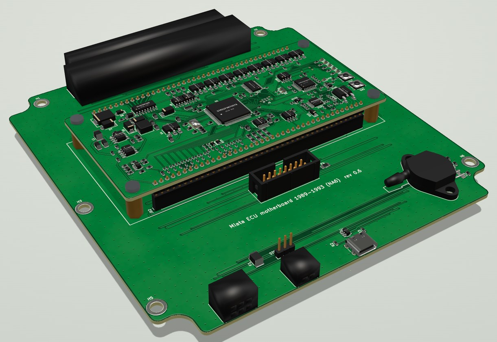
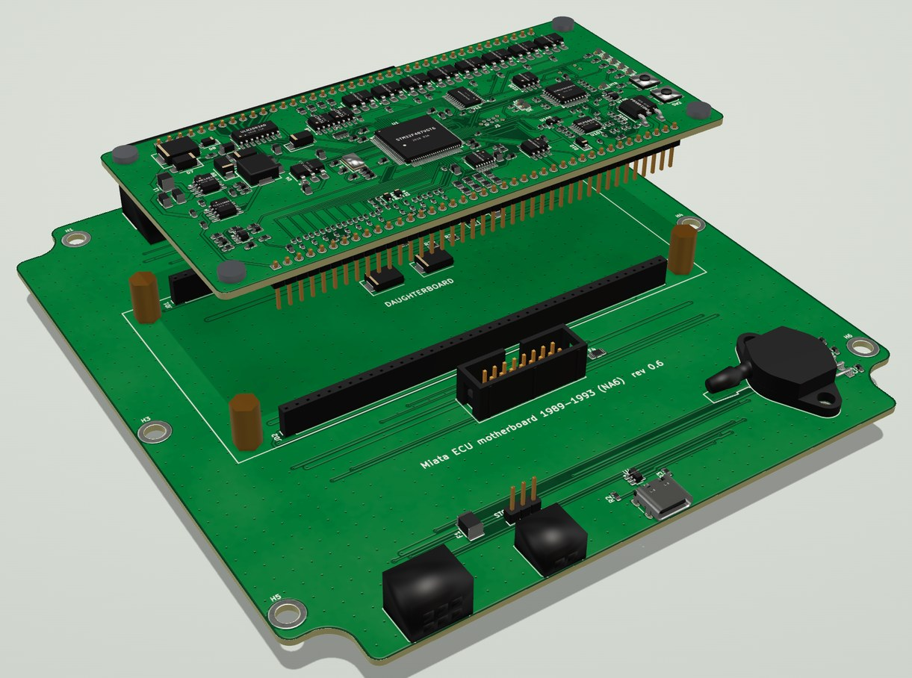
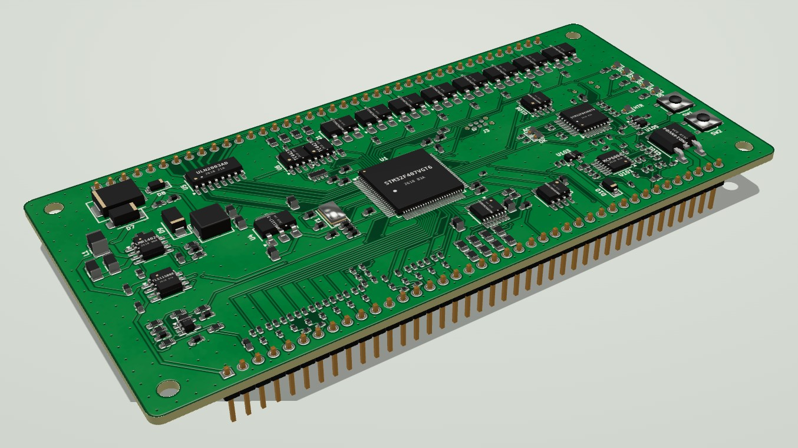

# miata-ecus

A plug-in [rusEFI](https://rusefi.com) engine computer for the 1989–2005 Mazda Miata (NA and NB). It has two parts:

- **One universal daughterboard.** It does all the engine control: an STM32F407 running rusEFI, plus an on-board
  LSU 4.9 wideband controller (the open-source FOME/rusEFI design).
- **A motherboard for each model year.** Each one fits the stock ECU case, takes the stock harness connector and
  carries the year-specific wiring, the MAP sensor, the LSU/IAT connectors and USB-C.

The daughterboard plugs into the motherboard on two 1×40 sockets and four M3 standoffs.



<table>
<tr>
<td width="50%"></td>
<td width="50%"></td>
</tr>
<tr>
<td align="center"><sub>Daughterboard lifted off its sockets and standoffs</sub></td>
<td align="center"><sub>The universal daughterboard (rev 0.4)</sub></td>
</tr>
</table>

<sub>Renders from the 3D viewer in <a href="viewer/"><code>viewer/</code></a>. The harness header, the LSU and IAT connectors and the MAP sensor are simplified stand-in models.</sub>

> **Status:** every board is fully routed and passes KiCad DRC (no clearance errors, no unconnected items), and each
> schematic's netlist has been checked pad-by-pad against its board. **None of them has been built or tested yet**, and
> no person has reviewed the schematics. Read each board's README, especially its *Still to verify* or *Before ordering* list.
>
> **Verification (desk + simulation, 2026-10-30):** [VERIFICATION.md](VERIFICATION.md). Pinouts and firmware check out
> for all five years (after fixing a firmware bug that would have cut fuel and spark on 1996-2002 cars). The hardware
> changes it called for are in daughterboard rev 0.5 and motherboards rev 0.6 (1989-95) / 0.4 (1996-2005):
> - 5 V drive for the low-side drivers, held off until the firmware runs;
> - freewheel diodes on the idle and VVT valves;
> - BOOT1 pull-down;
> - no 2003-05 key-off back-feed;
> - a fused, clamped logic supply and a fused AUX +12 V pin;
> - clamped crank/cam inputs;
> - two drivers per injector wire on 1989-93.
>
> Every fix was re-simulated. Two wires still need checking on a car.

| Board | Folder | Rev | Harness header | Case fit |
|---|---|---|---|---|
| Daughterboard (all years) | [`daughterboard/`](daughterboard/) | 0.5 | 2 × 1×40 to the motherboard | 125 × 60 mm, 4 layers |
| 1989–93 (NA6) | [`motherboards/1989-93/`](motherboards/1989-93/) | 0.6 | TE 174917-6, 48 pins | stock NA case outline |
| 1994–95 (NA8) | [`motherboards/1994-95/`](motherboards/1994-95/) | 0.6 | TE 174917-6, 48 pins | stock NA case outline |
| 1996–97 (NA8, OBD-II) | [`motherboards/1996-97/`](motherboards/1996-97/) | 0.4 | TE 178780-1, 76 positions | **provisional** (NA outline) |
| 1999–2000 (NB1) | [`motherboards/1999-2000/`](motherboards/1999-2000/) | 0.4 | TE 176122-6, 64 positions | **provisional** (NA outline) |
| 2001–05 (NB2, VVT) | [`motherboards/2001-05/`](motherboards/2001-05/) | 0.4 | TE 353830-5, 72 positions | **provisional** (NA outline) |

Each board folder contains:
- the KiCad 7 project (schematic and board);
- a schematic PDF;
- JLCPCB gerbers, BOM and placement files in `fab/`, with the DRC report. The JLC BOM is the SMD parts (and USB-C);
  `fab/self_order_bom.csv` is everything you order and solder yourself, and
  [`docs/order_all_boards.csv`](docs/order_all_boards.csv) adds up all five motherboards, five daughterboards and the in-car parts;
- renders;
- a README with the pinout, assembly notes and open questions.

## Firmware and flashing
The rusEFI board definition is in [`firmware/`](firmware/): pin map, year presets, and a flasher for the wideband MCU.
GitHub Actions builds it on every push: the firmware, the rusEFI console bundle and the TunerStudio `.ini`.
See [`firmware/README.md`](firmware/README.md). It compiles, but hasn't run on hardware yet.
- **One USB-C port for everything.** The USB-C on the motherboard's bottom edge goes to the main MCU (STM32F407).
  - **First flash:** ST's DFU mode (hold BOOT, tap RESET).
  - **Later updates:** from the rusEFI console through the OpenBLT bootloader, with no buttons to press.
  - **Tuning:** TunerStudio over the same port. Popular Vehicles picks the model year; the tune is stored in the
    MCU's flash.
- **The wideband MCU (STM32F042) is programmed through the main MCU.** With the engine off, press "Flash on-board
  wideband" in TunerStudio, or type `wbo_uart_flash` in the rusEFI console.
  - The main MCU controls the F042's BOOT0 and reset lines and writes the wideband firmware through the F042's
    built-in ST serial bootloader.
  - After that, rusEFI can also update the wideband over CAN.
  - The SWD Tag-Connect pads on the bottom of the daughterboard (J102) are a fallback.

## Air temperature sensor
Each motherboard has an IAT jumper (JP1, a 3-pin header with a removable shunt) next to the IAT connector:
- **EXT (default):** the aftermarket M12 thermistor on the IAT connector.
- **STOCK:** the stock sensor through the harness. It sits inside the flap-type AFM on 1989–97 and inside the MAF on
  1999–2005, so it's only available while that meter stays in the intake.

Pick the matching sensor curve in TunerStudio. The firmware already accounts for the board's 2.7 kΩ pull-up and divider.

## Things to know before ordering
- **1996–2005 case geometry is a placeholder.** These motherboards use the NA board outline and mounting holes until a
  stock 96–97 / NB case is measured. The 76-pin 96–97 header is 130 mm wide and must clear the real case.
- **2001–05 Mazdaspeed:** pin 4R is the second intake-air-temperature sensor on the turbo cars, not the VVT valve.
  Don't fit the 01–05 board to a Mazdaspeed unmodified.
- **Wideband layout is new.** The wideband *circuit* is FOME's proven design. Since daughterboard rev 0.3 its *layout*
  is this board's own, so bring it up and check it against a known sensor before relying on it.
- **MAP sensor:** an MPX5700AP (absolute, single barb), fitted flat with its marking up. The barb's position on the
  footprint was taken from a photo; check it against a real part.

## Repository layout
| Path | What |
|---|---|
| `daughterboard/`, `motherboards/<years>/` | The released boards (see above) |
| `scripts/` | The design source. Every board is generated from Python: parts, netlist, placement, a grid router, schematic generation, release packaging |
| `mb/ecu_mb.pretty/` | Project footprints (harness headers named by OEM terminal, the flat MPX5700AP, USB-C, M4 case hole) |
| `research/` | Pinout research for 1996–2005 (sources compared per pin) |
| `viewer/` | Interactive 3D viewer: the daughterboard alone, or assembled on any year's motherboard. Click a part for its details and shop links |
| `firmware/` | The rusEFI board definition, the wideband flasher, the simulation tests and the verification tools. rusEFI itself is a submodule in `firmware/ext/rusefi` |
| `VERIFICATION.md` | Pinout, datasheet, simulation, flashing and safety review, with the hardware changes it calls for |
| `.github/workflows/firmware.yaml` | CI: checks the pin map against the board design and builds the firmware |

## Rebuilding
You need:
- **KiCad 7.0** with its Python `pcbnew` module, and `kicad-cli`;
- **Python 3** with `shapely`, `numpy`, `scipy`, `openpyxl` and `matplotlib`;
- **`rsvg-convert`**, for the renders.

```sh
# daughterboard: build, route, finish, then the release folder
scripts/daughter_make.sh work/daughter
scripts/daughter_release.sh work/daughter/finished.kicad_pcb out/daughterboard

# a motherboard: <year module> <short name> <rev>, e.g. 1999-2000
scripts/mb_make.sh mb_nb1 9900 0.2      # writes mb/release_9900
```

Routing takes 10–40 minutes per board.

`mk_hdr_fp.py` reads the harness-header geometry from the rusEFI hellen-one boards and KiCad library. Point it at them
with `MIATA_REF` and `RUSEFI_LIBS`. The generated footprints are already in `mb/ecu_mb.pretty/`.

The firmware build is described in [`firmware/README.md`](firmware/README.md).

The viewer is a static page. To open it, run `cd viewer && python3 -m http.server`, then browse to `http://localhost:8000`.
`viewer/pcb3d.py` rebuilds its assets from a board; it also needs `trimesh`, `cascadio`, `Pillow` and `gltfpack`.

## Credits and licences
- This project (the board designs, scripts and viewer) is released under the [MIT licence](LICENSE).
- The wideband controller circuit is the FOME / rusEFI open-source wideband module
  ([mck1117/wideband](https://github.com/mck1117/wideband), `board_module` rev C, MIT licence). Its source files and
  licence are in `scripts/wideband_ref/`.
- The circuit topologies follow rusEFI's hellen-one modules, and the harness pinouts were cross-checked against the
  rusEFI hellen Miata boards and the Mazda workshop manuals (see `research/`).
