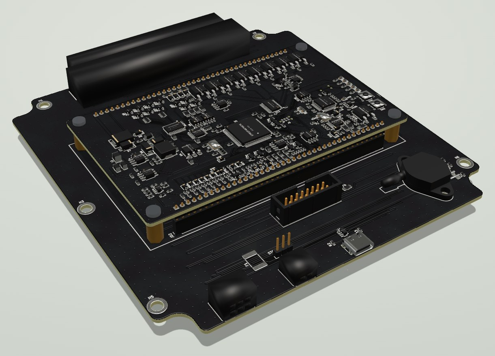
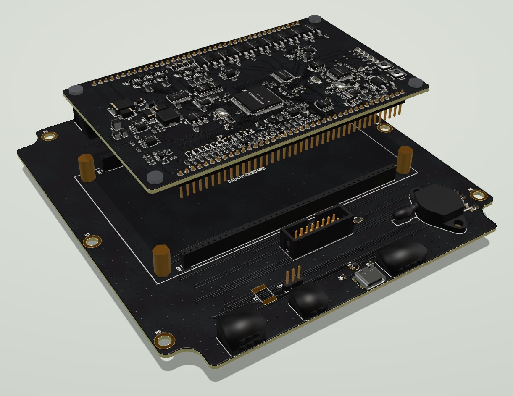
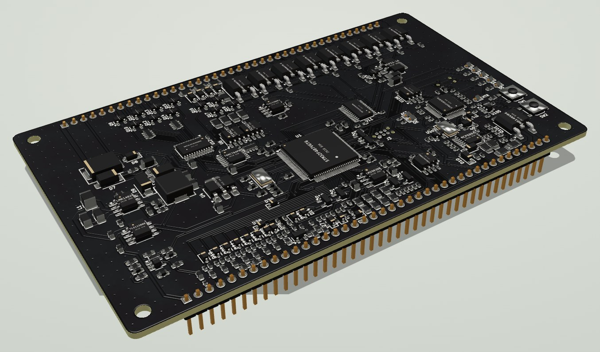

# miata-ecus

A plug-in [rusEFI](https://rusefi.com) engine computer for the 1989–2005 Mazda Miata (NA and NB). It has two parts:

- **One universal daughterboard.** It does all the engine control: an STM32F407 running rusEFI, plus an on-board
  LSU 4.9 wideband controller (the open-source FOME/rusEFI design).
- **A motherboard for each model year.** Each one fits the stock ECU case, takes the stock harness connector and
  carries the year-specific wiring, the MAP sensor, the wideband sensor plug, the add-on header and USB-C.

The daughterboard plugs into the motherboard on two 1×40 sockets and four M3 standoffs.



<table>
<tr>
<td width="50%"></td>
<td width="50%"></td>
</tr>
<tr>
<td align="center"><sub>Daughterboard lifted off its sockets and standoffs</sub></td>
<td align="center"><sub>The universal daughterboard (rev 0.9)</sub></td>
</tr>
</table>

<sub>The pictures and the 3D viewer still show the previous board set (daughterboard rev 0.9); the current boards differ as listed under <a href="#features-and-limitations">Features</a> and in <a href="INSTALL.md#whats-what">INSTALL.md</a>. Renders from the 3D viewer in <a href="viewer/"><code>viewer/</code></a>, with black solder mask (<code>MASK=black</code> in <code>viewer/pcb3d.py</code>). The harness header, the LSU and IAT connectors, the MAP sensor and the heater fuse F1 are simplified stand-in models.</sub>

**Fitting one to a car:** [INSTALL.md](INSTALL.md) has labelled pictures of every connector, the header pin maps, the
MAP hose and wideband for each year, and the first start.

## Features and limitations

No board has been built yet. "Can" below means the hardware is designed for it and the firmware is set up for it; where
the firmware part has run in [emulation](firmware/sim/), that is as far as the proof goes.

### What it can do

**On every year**
- **Plugs into the stock harness** and fits the stock ECU's case (1990–95; the 1996–2005 fit is unchecked).
- **Fuel from manifold pressure** (speed-density), with the MAP sensor on the board. The stock airflow meter is not
  used and can come out of the intake.
- **MAP sensor good for boost:** 15–700 kPa absolute, so a turbo or supercharger needs no sensor change.
- **Wideband oxygen sensor controller on the board** for a Bosch LSU 4.9. No separate gauge or controller box. The
  board's plug is meant for AEM's ready-made X-Series sensor harness (30-3427).
- **Closed-loop fuel from the wideband**, switched on from the first start: ±10 % at idle and cruise, +10 / −5 %
  under load.
- **A base tune for each year**, loaded by the year button in TunerStudio ([what is in it](firmware/README.md#base-tune)).
- **Four injector outputs** for high-impedance injectors. Sequential on 1994–2005; in pairs on 1989–93, as the
  stock harness is wired (a jumper pair on that board is for a sequential conversion).
- **Four ignition outputs** (5 V logic): two on the harness for the stock coils, two more on the AUX header for one
  coil per cylinder.
- **Closed-loop idle** (on cars with a throttle position sensor), radiator fan, second fan, A/C clutch, fuel pump,
  check-engine light and tachometer, on the stock wires.
- **One USB-C port** for tuning (TunerStudio) and firmware updates, including the wideband's firmware.
- **Logging to a microSD card** in a socket on the daughterboard (rusEFI's own logger).
- **Protected outputs.** Every driver limits its current and shuts down when it overheats. In simulation every
  harness pin was shorted to ground, 14.4 V and 24 V; what still fails is listed in
  [VERIFICATION.md](VERIFICATION.md#rev-08-driver-temperature-and-protected-outputs).

**By year**

| | 1989–93 | 1994–95 | 1996–97 | 1999–2000 | 2001–05 |
|---|---|---|---|---|---|
| Injection | pairs | sequential | sequential | sequential | sequential |
| Variable valve timing | – | – | – | – | closed loop, rusEFI's target table |
| Knock sensor | add your own | add your own | add your own | stock sensor | stock sensor |
| Alternator voltage | alternator's own | alternator's own | alternator's own | ECU, ships off | ECU, ships off |
| Main relay held by the ECU | – | – | – | – | 2003–05 |
| Stock oxygen-sensor heater | – | – | driven | driven | not driven |
| Throttle position | switch only on manual cars | sensor | sensor | sensor | sensor |

**For a turbo and other add-ons** (the 20-pin add-on header, [pin map](INSTALL.md#header-pin-maps))
- Boost-control valve output, already assigned in the firmware, with a fused 12 V for the valve.
- **Flex-fuel sensor input** (GM / Continental type).
- **Nitrous arming input** for rusEFI's nitrous control.
- **CAN bus** for a dash or gauges: the bus the on-board wideband reports on.
- Knock sensor input for the cars that have none.
- Coil 3 and coil 4 outputs.
- A spare 0–5 V analog input, two inputs for magnetic (VR) crank and cam sensors, 5 V and a fused 12 V.
- rusEFI's own functions are all in the firmware (launch control, boost by table or closed loop, knock retard,
  general-purpose PWM tables, Lua scripts). None of them is set up or tested on this board.

### What it can't do

- **It is untested.** No board has been assembled, powered or run in a car.
- **The base tune is a starting point.** The tables came from other people's cars. Nobody has tuned them under
  boost, and the 1989–97 fuel table stops at 128 kPa.
- **No drive-by-wire throttle.** Every supported car has a cable throttle; this only matters for an engine swap.
- **High-impedance injectors only**, and the ignition outputs need coils with built-in igniters or the stock
  igniter. They can't drive a bare coil.
- **One wideband**, four cylinders.
- **The stock case has to be cut** for the wideband plug, USB-C, the MAP hose and the add-on ribbon cable. The
  1996–2005 boards still have the 1990–95 outline and mounting holes.
- **The add-on header is a ribbon-cable header inside the case**, not a sealed plug, and its 12 V pin is fused at
  1.1 A.
- **Sustained high rpm in a hot cabin is the thermal limit**, most of all on 1989–93 cars: see
  [Things to know before ordering](#things-to-know-before-ordering).
- **1990–93:** the fuel pump is switched by the airflow meter, so removing the meter needs one added wire
  ([INSTALL.md](INSTALL.md#199093)). Manual cars have no throttle position sensor until one is
  [fitted](#throttle-position-sensor-198993-manual-cars).
- **1999–2005:** alternator control ships switched off until the wire has been checked on a car.
- **Not street legal as an emissions device.** No OBD-II diagnostics or readiness monitors, no immobiliser, and it
  doesn't run the EGR valve, the 1999–2005 purge valve, the 2001–05 intake shutter valves (VTCS) or the rear oxygen
  sensor. The 1999–2000 VICS solenoid is wired but not set up.
- **Automatic cars are untested**, and the transmission unit's signals are mostly left unconnected.
- **2004–05 Mazdaspeed is not supported.**

> **Status:** every board is fully routed and passes KiCad DRC (no clearance errors, no unconnected items), and each
> schematic's netlist has been checked pad-by-pad against its board. **None of them has been built or tested yet**, and
> no person has reviewed the schematics. Read each board's README, especially its *Still to verify* or *Before ordering* list.
>
> **Verification (desk + simulation, 2026-10-30):** [VERIFICATION.md](VERIFICATION.md). Pinouts and firmware check out
> for all five years (after fixing a firmware bug that would have cut fuel and spark on 1996-2002 cars). The hardware
> changes it called for are in daughterboard rev 0.5 and motherboards rev 0.6 (1989-95) / 0.4 (1996-2005):
> - 5 V drive for the low-side drivers, held off until the firmware runs;
> - freewheel diodes on the idle and VVT valves;
> - BOOT1 pull-down;
> - no 2003-05 key-off back-feed;
> - a fused, clamped logic supply and a fused AUX +12 V pin;
> - clamped crank/cam inputs;
> - two drivers per injector wire on 1989-93.
>
> Every fix was re-simulated. Two wires still need checking on a car.
>
> **Full-firmware emulation (2026-11-02):** the unmodified rusEFI firmware runs on an emulated STM32F407 through every
> model year with 0 failures (two firmware bugs found and fixed). It flashes a blank emulated wideband STM32F103, which
> then reports lambda over CAN (`firmware/sim/`). The expanded circuit and fault checks found 13 new hardware items
> (N1-N13). Daughterboard rev 0.7 and the motherboards' 3 A heater fuse fixed most of them; see
> [Rev 0.7](VERIFICATION.md#rev-07-fixes-for-the-2026-11-02-findings).
>
> **Rev 0.8 (2026-11-03):** a larger daughterboard (125 × 76 mm) with DPAK injector drivers on drain copper and thermal
> vias (estimated 110 °C at 90 % duty and 85 °C ambient, where rev 0.7 reached thermal shutdown), protected relay, lamp,
> tach and ignition outputs, a separate protected 5 V for the harness sensors, LSU drive clamps, a +3V3 shunt clamp and
> fault-tolerant CAN transceivers. Every harness cavity shorted to ground, 14.4 V and 24 V: 4 failures left (rev 0.7:
> 215), all the LSU drive resistors taking a battery short so the ICs don't. See
> [Rev 0.8](VERIFICATION.md#rev-08-driver-temperature-and-protected-outputs).
>
> **Rev 0.9:** layout only. J1 is back on the daughterboard's top edge with the driver strip below it, and the
> daughterboard sits 16 mm lower, centred on each motherboard. Re-checked: same results as rev 0.8.
>
> **1989–93 motherboard rev 0.11:** the manual cars' throttle position sensor conversion uses the stock throttle switch
> plug, through three 0 Ω links. Pin 1N is no longer wired straight to the sensor 5 V, which the stock switch would have
> shorted at every idle. See [Throttle position sensor (1989–93 manual cars)](#throttle-position-sensor-198993-manual-cars).
>
> **Rev 0.10 (2026-11-13):** the daughterboard is now six layers in the same outline, with a turn-off clamp per
> injector, a microSD socket and flex-fuel and nitrous inputs; the motherboards take AEM's wideband harness and have a
> 20-pin add-on header with CAN, and 1989–93 and 1994–95 share one board set by jumpers. Before the layout every
> figure the design rests on was read again from its maker's document. That found a series resistor the injector
> drivers' inputs should always have had, and showed that the injector inductance behind every temperature estimate
> was a guess. A model of the whole board's copper now gives those temperatures. See
> [Rev 0.10](VERIFICATION.md#rev-010-six-layers-injector-clamps-card-socket-two-more-inputs-2026-11-13).
>
> **The boards ordered in November 2026** are the set before this (daughterboard rev 0.9). Their files are kept in
> [`ordered-boards/2026-11/`](ordered-boards/2026-11/); what the rev 0.10 review means for them is in
> [VERIFICATION.md](VERIFICATION.md#the-ordered-rev-09-boards).

| Board | Folder | Rev | Harness header | Case fit |
|---|---|---|---|---|
| Daughterboard (all years) | [`daughterboard/`](daughterboard/) | 0.10 | 2 × 1×40 to the motherboard | 125 × 76 mm, 6 layers |
| 1989–95 (NA6 and NA8; jumpers set 1989–93 or 1994–95) | [`motherboards/1989-95/`](motherboards/1989-95/) | 0.12 | TE 174917-6, 48 pins | stock NA case outline |
| 1996–97 (NA8, OBD-II) | [`motherboards/1996-97/`](motherboards/1996-97/) | 0.8 | TE 178780-1, 76 positions | **provisional** (NA outline) |
| 1999–2000 (NB1) | [`motherboards/1999-2000/`](motherboards/1999-2000/) | 0.8 | TE 178780-1, as 1996–97 (the car's own is the 64-position 176122-6; its plugs are the same housings) | **provisional** (NA outline) |
| 2001–05 (NB2, VVT) | [`motherboards/2001-05/`](motherboards/2001-05/) | 0.8 | TE 353830-5, 72 positions | **provisional** (NA outline) |

Each board folder contains:
- the KiCad 7 project (schematic and board);
- a schematic PDF;
- JLCPCB gerbers, BOM and placement files in `fab/`, with the DRC report, named for the board and revision (for example
  `miata-ecu-motherboard-1989-95-rev0.12_jlcpcb_gerbers.zip`). The JLC BOM is the SMD parts (and USB-C);
  `…_self_order_bom.csv` is everything you order and solder yourself, and
  [`additional-parts/order_all_boards.csv`](additional-parts/order_all_boards.csv) adds up every motherboard, a daughterboard for each and the in-car parts
  (the same list as a page with quantities and tick boxes: [`additional-parts/shopping_list.html`](additional-parts/shopping_list.html));
- renders;
- a README with the pinout, assembly notes and open questions.

## Firmware and flashing
The rusEFI board definition is in [`firmware/`](firmware/): pin map, year presets, and a flasher for the wideband MCU.
GitHub Actions builds it on every push: the firmware, the rusEFI console bundle and the TunerStudio `.ini`.
See [`firmware/README.md`](firmware/README.md). It compiles, but hasn't run on hardware yet.
- **One USB-C port for everything.** The USB-C on the motherboard's bottom edge goes to the main MCU (STM32F407).
  - **First flash:** ST's DFU mode (hold BOOT, tap RESET).
  - **Later updates:** from the rusEFI console through the OpenBLT bootloader, with no buttons to press.
  - **Tuning:** TunerStudio over the same port. Popular Vehicles picks the model year; the tune is stored in the
    MCU's flash.
- **The wideband MCU (STM32F103) is programmed through the main MCU.** With the engine off, press "Flash on-board
  wideband" in TunerStudio, or type `wbo_uart_flash` in the rusEFI console.
  - The main MCU controls the F103's BOOT0 and reset lines and writes the wideband firmware through the F103's
    built-in ST serial bootloader. The firmware is rusEFI's wideband controller with this board's port
    (`firmware/wideband`), and the main firmware carries it.
  - The SWD Tag-Connect pads on the bottom of the daughterboard (J102) are a fallback.

## Air temperature sensor
The stock sensor's harness wire goes straight to the ECU's air-temperature input: inside the airflow meter on 1989–97,
in the air filter box on 1999–2005. There is no separate connector for it on the board since motherboard rev 0.12 / 0.8.
With the airflow meter or airbox removed, put an open-element sensor on the stock sensor's plug
([INSTALL.md](INSTALL.md#7-air-temperature)) and pick its curve in TunerStudio. The firmware already accounts for the
board's 2.7 kΩ pull-up and divider.

## Throttle position sensor (1989–93 manual cars)
The 1989–93 manual cars have no throttle position sensor: the part on the throttle body is a switch with an idle
contact and a full-throttle contact. The automatics have a real 0–5 V sensor on 2M, as do all 1994–2005 cars. The ECU
calculates fuel from its MAP sensor, so a manual car runs without one, but rusEFI then treats the throttle sensor as
failed: no closed-loop idle, no throttle-based acceleration fuel and no overrun fuel cut.

The switch's plug has three wires: idle contact (1N), ground (2D) and full-throttle contact (2L). A sensor needs
three: 5 V, ground and signal. So, as on rusEFI's Hellen NA6 and MRE boards, a sensor plugs into the stock plug and the
1989–95 motherboard sets those pins with 0 Ω links: **fit R28** (5 V on 1N) and **move R29 to R30** (2L to
the throttle input). The kit, in the board's self-order BOM as "Manual cars":
- **Sensor:** a Kia sensor with the same 3-pin Mazda plug (Kia 0K01118911, or the others the
  [rusEFI wiki](https://wiki.rusefi.com/Legacy-Miata-NA-48-pin-board-for-MRE) lists).
- **Mount:** [Mazda NA6 Miata variable TPS mount](https://www.thingiverse.com/thing:3414132), printed in ASA.
- **Or instead:** [Flyin' Miata's TPS upgrade kit](https://flyinmiata.com/products/tps-upgrade) with its sensor.

Check the plug's wiring and the sensor's pins on your car before fitting R28: see the
[1989–95 README](motherboards/1989-95/README.md). Automatics leave R28 and R30 off.

## Things to know before ordering
- **Measure one injector's inductance first** (LCR meter, injector unplugged). The heat the injector clamps put into
  the board scales with it, and it is not known for Miata injectors: the design is sized for 20 mH, earlier revisions
  assumed 8 mH. At sustained 7200 rpm with 20 mH injectors the board model puts the processor 32–40 °C above the air
  around the board on 1994–2005 cars and 42–54 °C on 1989–93 cars, against a 105 °C junction rating. The 125 °C grade
  of the processor (STM32F407VGT7) fits the same pads and costs about five times as much. Numbers and options:
  [VERIFICATION.md](VERIFICATION.md#board-temperature).
- **The wideband plug's family is assumed.** The motherboards carry a Molex Micro-Fit 3.0 2×4 header for AEM's
  X-Series sensor harness 30-3427. AEM publishes the pin functions, not the connector: check a harness against the
  header before ordering boards.
- **Clamp TVS stock.** The daughterboard's injector clamp TVS (Vishay TPSMC16A) is in JLCPCB's library, but its stock
  could not be confirmed; the [daughterboard README](daughterboard/README.md#before-ordering) names the alternate.
- **1996–2005 case geometry is a placeholder.** These motherboards use the NA board outline and mounting holes until a
  stock 96–97 / NB case is measured. The 76-pin 96–97 header is 130 mm wide and must clear the real case.
- **2001–05 Mazdaspeed:** pin 4R is the second intake-air-temperature sensor on the turbo cars, not the VVT valve.
  Don't fit the 01–05 board to a Mazdaspeed unmodified.
- **Wideband layout is new.** The wideband *circuit* is FOME's proven design. Since daughterboard rev 0.3 its *layout*
  is this board's own, so bring it up and check it against a known sensor before relying on it.
- **MAP sensor:** an MPX5700AP (absolute, single barb), fitted flat with its marking up. The barb's position on the
  footprint was taken from a photo; check it against a real part.

## Repository layout
| Path | What |
|---|---|
| `daughterboard/`, `motherboards/<years>/` | The released boards (see above) |
| `scripts/` | The design source. Every board is generated from Python: parts, netlist, placement, a grid router, schematic generation, release packaging |
| `mb/ecu_mb.pretty/` | Project footprints (harness headers named by OEM terminal, the flat MPX5700AP, USB-C, M4 case hole) |
| `research/` | Pinout research for 1996–2005 (sources compared per pin); the rev 0.10 design audit (every figure the board relies on, its source, and what could not be checked); ST's pin data files |
| `ordered-boards/2026-11/` | The board set ordered in November 2026 (daughterboard rev 0.9), as ordered |
| `viewer/` | Interactive 3D viewer: the daughterboard alone, or assembled on any year's motherboard. Click a part for its details and shop links. Not yet rebuilt for rev 0.10: it shows the rev 0.9 board set |
| `firmware/` | The rusEFI board definition, the wideband flasher, the simulation tests and the verification tools. rusEFI itself is a submodule in `firmware/ext/rusefi` |
| `website/` | A black-and-white Shopify theme for selling the boards, draft product listings and product photos ([website/README.md](website/README.md)) |
| `INSTALL.md` | Fitting the ECU to a car: labelled pictures, header pin maps, the MAP hose and wideband per year, first start |
| `images/` | Renders, and the labelled pictures and pin maps (`scripts/annotate.py` redraws those from the board files) |
| `VERIFICATION.md` | Pinout, datasheet, simulation, flashing and safety review, with the hardware changes it calls for |
| `.github/workflows/firmware.yaml` | CI: checks the pin map against the board design and builds the firmware |

## Rebuilding
You need:
- **KiCad 7.0** with its Python `pcbnew` module, and `kicad-cli`;
- **Python 3** with `shapely` 2, `numpy`, `scipy`, `Pillow`, `openpyxl` and `matplotlib`;
- **`rsvg-convert`**, for the renders.

```sh
# daughterboard: build, route, finish, then the release folder
LAYERS=6 scripts/daughter_make.sh work/daughter
scripts/daughter_release.sh work/daughter/finished.kicad_pcb out/daughterboard

# a motherboard: <year module> <short name> <rev>, e.g. 1999-2000
scripts/mb_make.sh mb_nb1 9900 0.8      # writes mb/release_9900
```

Routing takes 10–40 minutes per motherboard and about an hour for the daughterboard.

`mk_hdr_fp.py` reads the harness-header geometry from the rusEFI hellen-one boards and KiCad library. Point it at them
with `MIATA_REF` and `RUSEFI_LIBS`. The generated footprints are already in `mb/ecu_mb.pretty/`.

The firmware build is described in [`firmware/README.md`](firmware/README.md).

The viewer is a static page. To open it, run `cd viewer && python3 -m http.server`, then browse to `http://localhost:8000`.
`viewer/pcb3d.py` rebuilds its assets from a board; it also needs `trimesh`, `cascadio`, `Pillow` and `gltfpack`.

The labelled pictures and pin maps in [INSTALL.md](INSTALL.md) come from the viewer and the board files:
`scripts/annotate.py --three <unpacked three@0.160.0 package>` redraws them (needs Playwright with Chromium, and `Pillow`).

## Credits and licences
- This project (the board designs, scripts and viewer) is released under the [MIT licence](LICENSE).
- One firmware file is GPL-3.0: `firmware/board/miata_nb_tune.cpp` holds the 1999–2005 base tune tables, copied from
  rusEFI. The firmware you build includes rusEFI, so the built firmware is GPL-3.0 as a whole
  ([firmware/README.md](firmware/README.md#licences)).
- The wideband controller circuit is the FOME / rusEFI open-source wideband module
  ([mck1117/wideband](https://github.com/mck1117/wideband), `board_module` rev C, MIT licence). Its source files and
  licence are in `scripts/wideband_ref/`.
- The circuit topologies follow rusEFI's hellen-one modules, and the harness pinouts were cross-checked against the
  rusEFI hellen Miata boards and the Mazda workshop manuals (see `research/`).
